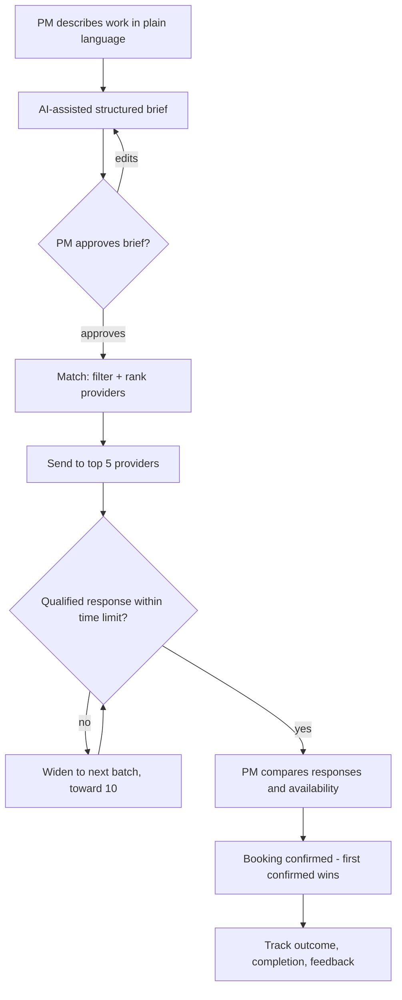

# 02 — User Flows

Companion to [plan.md](../plan.md) §3.

## Product principle

Every request moves through one loop: **confirm the brief → find suitable providers → collect responses → verify availability → confirm a booking → track the outcome.**

The product removes manual coordination rather than adding another administrative task.

## Request flow

## Project manager journey

1. Describes the work in plain language.
2. The platform helps create a structured request (AI brief builder where useful).
3. Confirms scope, location, timing, required trade, expected capacity and essential details.
4. The platform identifies suitable providers and explains why each was matched.
5. The request is sent to a limited group of relevant providers.
6. Providers respond with availability, capacity, and a quote or expression of interest.
7. The PM compares responses side by side.
8. The PM confirms a provider and booking.
9. The system records the commitment and tracks any changes.
10. After the work, both sides confirm completion and can leave feedback.

The PM always stays in control of provider selection and booking confirmation.

## Provider journey

1. Creates a free company profile.
2. Selects trades, service areas, project types, pricing approach (per hour, per m² or per project) and relevant qualifications.
3. Chooses how availability is shown: built-in booking system, connected calendar, or email only.
4. Receives relevant requests.
5. Reviews the brief and responds with availability, capacity, a quote or a decline.
6. If selected, confirms the commitment.
7. Can update availability, request a change or cancel according to the booking rules.
8. The platform records the outcome to improve future matching.

Essential provider actions must work on a mobile device without learning a complex new system.

## Providers are also customers

A subcontractor may need another subcontractor to complete its own project. The platform allows any company to act as both customer and provider — a single account model supports requesting, supplying and coordinating work.

This lets the network grow through subcontracting relationships rather than relying only on central sales and marketing.

**Contractual note:** in a subcontracting chain, the provider is the customer of its subcontractor. The platform connects parties but is not a party to their contract.

## UX principles

Based on construction-industry realities, the product must:

- **Work on mobile devices** — site managers and subcontractors are rarely at desks.
- **Require minimal training** — if users need a tutorial, the product is too complex.
- **Provide value on first use** — the first request should beat their existing method.
- **Respect existing workflows** — integrate with how companies already work.
- **Be transparent about limitations** — users must understand what the platform can and cannot verify.
