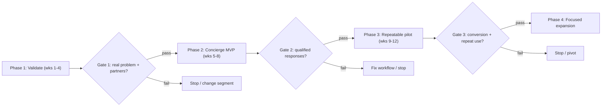

# 08 — Metrics and Pilot Gates

Companion to [plan.md](../plan.md) §9 and the roadmap gates.

## The pilot must answer three questions

1. Can we generate useful matches?
2. Can we turn matches into reliable commitments?
3. Will customers return, and can the business eventually support a viable revenue model?

Establish baselines before setting final targets; the numbers below are proposed hypotheses, refined after discovery.

## What success looks like after the pilot

- Project managers use us as the **first place** to look for subcontractors in the pilot trades.
- Most requests receive at least one accepted response within a set time.
- A growing share of providers keep their availability up to date in the booking system or a connected calendar.

## Pilot targets

| Metric | Proposed target | Measurement |
|---|---|---|
| Design partners | 3–5 active PMs | Signed agreements with request commitments |
| Supply | 30+ active providers across the pilot trades | Profile complete; contact verified; availability confirmed within 30 days |
| Request success | ≥70% of eligible requests get ≥1 qualified response within 24h | Requests with ≥1 qualified response ÷ eligible requests |
| Time to response | Median first qualified response < 4 business hours | Timestamp: request distribution → first qualified response |
| Booking conversion | ≥30% of eligible requests → confirmed booking | Confirmed bookings ÷ eligible requests |
| Repeat usage | ≥50% of active PMs submit another request | PMs with 2+ requests ÷ active PMs |
| Availability quality | ≥70% of responding providers confirm availability for requested dates | Confirmed availability ÷ total responses |
| Reliability | Accepted-but-not-delivered rate tracked from day one | Confirmed bookings where crew did not deliver ÷ confirmed bookings |
| Booking-system adoption | Growing share of email-only providers adopt the booking system | Booking-system providers ÷ all active providers |
| User satisfaction | Positive feedback from both sides | NPS > 30 or equivalent qualitative threshold |

**North star:** the percentage of eligible requests that reach a useful, confirmed outcome within an acceptable time. Not registrations, not profile counts.

## Metric definitions

Every metric has an explicit denominator. A customer-cancelled request is not the same as a failure to match.

| Metric | Numerator | Denominator | Exclusions |
|---|---|---|---|
| Request success rate | Requests with ≥1 qualified response within 24h | Eligible requests | Customer-cancelled requests |
| Booking conversion | Confirmed bookings | Eligible requests | Requests still open |
| Time to response | Median hours to first qualified response | Qualified responses | Automated responses |
| Repeat usage | PMs with ≥2 requests | Active PMs | PMs with only one project need |
| Availability confirmation | Responses with confirmed availability | Total provider responses | Provider-initiated declines |
| Provider activity | Providers receiving ≥1 request in last 30 days | Registered providers | Providers who opted out |

## Weekly dashboard

- New and active PMs; active providers by trade and region
- New requests and requests reaching completion
- % of requests with qualified responses; time to first qualified response
- Providers contacted per request; response and booking conversion rates
- Availability confirmation rate; cancellations and failed commitments
- Repeat usage
- Manual effort per successful booking
- Cost of acquiring and onboarding each side

## Roadmap gates — proceed, pivot, or kill

**Gate 1 — Validate the problem (weeks 1–4).** Proceed if:
- ≥7 of 10 interviewed PMs describe sourcing as a significant time drain.
- ≥5 of 10 report failed commitments or no-shows in the past 6 months.
- ≥3 PMs commit to pilot participation.
- ≥15 providers express willingness to receive relevant requests.

*Kill:* fewer than 4 of 10 PMs describe the problem as significant *and* providers show no interest in receiving requests → stop.
*Pivot:* the pain is real but concentrated in a different trade cluster or region → change the segment before building.

**Gate 2 — Concierge MVP (weeks 5–8).** Proceed if:
- ≥5 real requests processed through the platform.
- ≥70% of requests receive qualified responses within 24 hours.
- Design partners rate the experience better than their current process.
- ≥1 booking confirmed through the platform.

*Kill:* fewer than half of requests get any qualified response even with manual outreach to known-willing providers → matching value unproven → stop.

**Gate 3 — Repeatable pilot (weeks 9–12).** Proceed if:
- ≥10 requests processed.
- ≥30% booking conversion.
- ≥50% of design partners submit repeat requests.
- Manual effort per booking decreases week over week.
- ≥2 design partners express willingness to pay for continued access.

*Kill:* repeat usage under 25% and manual effort not declining → the platform is a one-off directory → stop or pivot to a pure sourcing service.

**Phase 4 — Focused expansion.** Calendar integrations, reliability scoring, advanced booking, more trades and regions, paid workflow features, Baltic markets — based on demonstrated demand and operational readiness, not development capacity.

## Key assumptions to test

| Assumption | Test method | Success threshold |
|---|---|---|
| PMs experience significant sourcing pain | Discovery interviews | 7/10 describe it as a significant time drain |
| Providers will share availability information | Provider interviews + pilot | 70% of active providers maintain current availability |
| Email-based responses reduce friction | Pilot comparison | Higher response rate than account-required flow |
| AI brief building saves meaningful time | Pilot measurement | Cuts request creation time by >50% |
| PMs return after first use | Pilot tracking | 50% submit a repeat request within 60 days |
| Companies will pay for workflow tools | Pricing experiments | ≥2 design partners commit to a paid pilot |
| 30 providers create sufficient liquidity | Pilot matching data | 70% of requests receive a qualified response |

## Glossary

| Term | Definition |
|---|---|
| Eligible request | A request approved by the PM, matched to ≥1 active provider, not cancelled by the customer |
| Qualified response | A response from an eligible provider with availability and either a quote or concrete interest |
| Active provider | Profile usable, contact valid, recently confirmed willingness to receive requests |
| Active PM | A design partner or user with at least one live project need during the period |
| Confirmed booking | Provider commitment accepted by the PM, recorded in the platform |
| Accepted-but-not-delivered | Confirmed booking where the crew did not show or work was not delivered |
| Design partner | PM/company with a signed pilot agreement to submit real requests and structured feedback |
