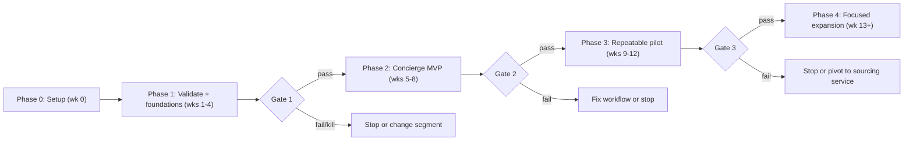

# Implementation Plan — Estonian Construction Subcontractor Marketplace

**Date:** 18 October 2026
**Companion to:** [plan.md](plan.md) (business plan) — this document turns it into an executable build and launch plan.

Phases here mirror the roadmap gates in [`details/08-metrics-and-pilot-gates.md`](details/08-metrics-and-pilot-gates.md). We do not start the next phase until its gate is met; kill/pivot criteria apply at every gate.

## Working assumptions (confirmed at the partner meeting)

- **Team:** 2 full-stack engineers, 1 founder covering product + customer research, 1 person covering supply/ops (can be the same founder early), fractional designer. If staffing differs, Phase durations shift, but the **sequence and gates do not**.
- **Stack (hard constraint — Cloudflare only, paid account):** Hono API + React frontend on Cloudflare Workers, D1 (SQLite) database, Cloudflare Access for staff auth, Cloudflare Email Service for transactional email (sending + delivery events via Queues), Workers AI for brief building, R2 for documents. EU residency via D1 EU location + R2 `eu` jurisdiction. Per the build-vs-buy table in [`details/06-mvp-scope-and-architecture.md`](details/06-mvp-scope-and-architecture.md).
- **No substantial development before** the Phase 0 decisions are made, per plan.md §13.

---

## Phase 0 — Decisions and setup (Week 0, partly parallel with interview recruiting)

**Goal:** remove every blocker so Phase 1 workstreams can run without waiting on decisions.

| # | Task | Output | Owner |
|---|---|---|---|
| 0.1 | Hold the partner meeting; settle the 6 decisions from plan.md §12 (segment, booking build-vs-adapt, MVP scope, team/budget, legal set-up, success criteria) | Decision log with owner + deadline per item | Partners |
| 0.2 | Kick off company/legal set-up; start Terms of Use draft; schedule GDPR review (worker names/schedules are personal data) | Entity in formation; legal checklist from [`details/10-risks-and-legal.md`](details/10-risks-and-legal.md) assigned | Legal |
| 0.3 | Research access and reuse terms: Äriregister, tax debt data, MTR, Smart-ID/Mobile-ID | Written findings — this gates badge work (Phase 3) and profile pre-seeding (Phase 2) | Product |
| 0.4 | Provision infrastructure on Cloudflare (paid account): git repo + CI baseline, Workers project with staging/production environments, D1 databases (EU location), Access applications + staff policy, error tracking (Workers observability) | "Hello world" deployed to staging and prod behind Access | Engineering |
| 0.5 | Define the analytics event schema for the full funnel (13 events from 06) **before any product code**; pick the analytics store | Event schema doc + tracking plan | Product + Eng |
| 0.6 | Draft data model v1: the 13 core entities (Company, User, Service, Availability declaration, Request, Match, Outreach, Response, Booking, Document, Review/outcome, Audit event + relations) | Migration files skeleton + ERD | Engineering |
| 0.7 | Sketch key screens: provider onboarding, request via AI chat, response email, availability view (plan.md §14) | Wireframes sufficient to build Phase 2 UI | Design |
| 0.8 | Estimate build + runway costs to Gate 3 | Cost estimate for the day-30 deliverable | Partners |

**Exit criteria:** every Phase 0 decision has an owner and a date; hosting and repo live; register findings written; event schema approved.

**Deliverable at day 30 (feeds Phase 1):** prioritised MVP spec, 60-day delivery plan, cost estimate, explicit go/no-go.

---

## Phase 1 — Validate the problem, lay foundations (Weeks 1–4) — Gate 1

**Goal:** prove the problem is real with evidence, sign design partners, and ship the infrastructure the concierge pilot will run on. **Ship almost no customer-facing product yet.**

### Workstream A — Discovery (product + founder)

| Week | Task |
|---|---|
| 1 | Write interview guides (questions in [`details/07-gtm-and-liquidity.md`](details/07-gtm-and-liquidity.md) Phase 1); build interview pipeline to 10 PMs + 15 contractors |
| 2–3 | Run interviews; score each on the 6-dimension scorecard with evidence; log concrete recent examples, never hypotheticals |
| 4 | Synthesis: problem-severity map, segment confirmation or pivot signal, baselines for every pilot target in 08; go/no-go recommendation |

### Workstream B — Engineering foundations

| Week | Task |
|---|---|
| 1 | Finalise data model v1 from Phase 0 skeleton; implement migrations; seed/fixture strategy; audit-event table (immutable) |
| 2 | **Internal admin console ("concierge cockpit")** — the tool we run the pilot with: create/manage providers, create requests on behalf of PMs, log manual outreach, record responses and outcomes, tag each step manual vs automated |
| 3 | Email pipeline: onboard and verify the sending subdomain on Cloudflare Email Service early (domain warm-up), then transactional templates with **one-click Accept / Quote / Decline links with secure single-use expiring tokens**; consume `message.delivered`/bounce Queues events; self-hosted open tracking pixel on Workers (feeds `email_opened`) |
| 4 | Analytics events wired into admin console actions end-to-end; funnel dashboard v0 (may query the DB directly); smoke tests + staging data reset procedure |

### Workstream C — GTM prep

| Week | Task |
|---|---|
| 1–2 | Draft design partner agreement (content list in 07 Phase 2); build provider recruitment list from register data per Phase 0 findings |
| 3–4 | Convert interested interviewees: ≥3 PM commitments, ≥15 provider expressions of willingness |

### Gate 1 — proceed only if (from 08)

- ≥7/10 interviewed PMs describe sourcing as a significant time drain
- ≥5/10 report failed commitments or no-shows in the past 6 months
- ≥3 PMs commit to pilot participation
- ≥15 providers express willingness to receive relevant requests

**Kill:** <4/10 PMs find the problem significant *and* providers show no interest → stop.
**Pivot:** pain is real but in a different trade cluster/region → change segment before building anything customer-facing.

---

## Phase 2 — Concierge MVP: build the P0 slice, run real requests (Weeks 5–8) — Gate 2

**Goal:** ship the P0 product slice (plus the two P1 features that make the demo credible), process ≥5 real requests with design partners, confirm the first booking.

### Engineering — P0 features first (priority table in 06)

| Week | Task | Notes |
|---|---|---|
| 5 | Provider profiles: free listing with services, trade, skills, service area, pricing approach **and pricing model** (hour / m² / project) | Staff-assisted creation via admin console is acceptable at first |
| 5–6 | Structured request form + request lifecycle (draft → approved → matched → outreach → responses → booked → closed/cancelled); response model carrying capacity declaration: **how many people, from what date** | States must map 1:1 to funnel events |
| 6 | Matching v1: hard filters (trade, location, availability) + transparent weighted ranking from 04 — compute only from data that exists; diversity rule (≤2 per specialisation); **Outreach entity**: batch top 5, widen toward 10 on timeout, throttling, stop-on-fill/cancel, opt-outs | Ranking weights are hypotheses; tune in Phase 3 |
| 7 | **Booking core:** availability declarations (workers per skill per day), booking request → confirmation, **first-confirmed-wins enforced at the database level**, 48-hour holds behind a feature flag (test before making default), cancellation recording with attribution | Core differentiator — build carefully, per 03 |
| 7–8 | **AI brief builder (P1):** LLM drafts structured brief from natural language; missing info flagged, never invented; PM edits + approves before distribution; log proposal vs final edits | AI safeguards from 04 apply |
| 8 | Response comparison view (P1); request status view for the PM; end-to-end analytics verification: every one of the 13 funnel events fires from the real UI | |
| 8 | Hardening pass: auth roles, token expiry audit, error budgets, backup/restore rehearsal | |

### Ops — concierge runbook (running the pilot is a product activity)

| Task | Output |
|---|---|
| Write the runbook: how we clarify briefs, which providers we contact, follow-up cadence, outcome recording; every manual step logged as an intervention | Comparable `hours per request` data from day one |
| Personally onboard the first providers; pre-seed profiles from register data (per Phase 0 findings) | Supply for the first requests |
| Process ≥5 real requests with 3–5 design partners; structured feedback after each; weekly check-in calls | Gate 2 evidence |

**Gate 2 — proceed only if:**

- ≥5 real requests processed through the platform
- ≥70% of requests receive qualified responses within 24 hours
- Design partners rate the experience better than their current process
- ≥1 booking confirmed through the platform

**Kill:** fewer than half of requests get any qualified response even with manual outreach to known-willing providers → matching value unproven → stop.

---

## Phase 3 — Repeatable pilot: harden, measure, reduce manual effort (Weeks 9–12) — Gate 3

**Goal:** ≥10 requests, proven conversion and repeat usage, visibly declining manual effort. This phase converts a demo into a workflow.

### Engineering

| Week | Task | Notes |
|---|---|---|
| 9 | **Weekly dashboard** with every metric from 08 using the defined numerators/denominators; automate outreach widening + timeouts; PM-facing request status ("what has been done") | |
| 9–10 | **Booking hardening:** freshness rules (<7 / 7–14 / 14–30 / >30 days) driving display and reconfirmation prompts; tentative vs confirmed distinction; reschedule/cancel flows (propose → confirm → record); email-only providers labelled "Unconfirmed"; external-commitment disclaimer in UI | Rules from 03 |
| 10 | Verification badges (P1): business register check per Phase 0 findings; badge display rules; "to check" items from 05 stay deferred until terms allow | Scope guard: no tax debt / MTR / Smart-ID yet unless findings made them trivial |
| 11 | Ranking tuning from real data: response rate, conversion and completion per provider feed weights; explainability panel ("why this provider ranks here"); never rank by payment | Learning loop from 04 |
| 11–12 | Booking-system adoption funnel: after repeated successful email interactions, prompt email-only providers to the calendar view + signup | Email → booking-system conversion per 03 |
| 12 | Basic reporting (P2); performance pass; security + GDPR review: worker-data minimisation check, retention/deletion policy, document access permissions | Closes the phase-legal checklist |

### Ops and GTM

| Task | Target |
|---|---|
| Grow supply to **30+ active providers balanced across the six trades** (per-trade minimums in 07) | Electrical 6, plumbing 5, HVAC 4, drywall 5, flooring 4, painting 6 |
| Step down concierge support request by request; measure hours/request weekly | Declining trend is a Gate 3 criterion |
| Pricing discovery with every design partner (options in [`details/09-monetization.md`](details/09-monetization.md)); ask directly about paid continuation | ≥2 partners willing — Gate 3 criterion |

**Gate 3 — proceed only if:**

- ≥10 requests processed
- ≥30% booking conversion
- ≥50% of design partners submit repeat requests
- Manual effort per booking decreases week over week
- ≥2 design partners express willingness to pay for continued access

**Kill:** repeat usage <25% and manual effort not declining → one-off directory → stop or pivot to a pure sourcing service.

---

## Phase 4 — Focused expansion (Week 13+)

**Goal:** grow only what Gate 3 proved. Each item below gets its own mini-gate: hypothesis → success metric → decision date. Order follows expected demand, not developer enthusiasm.

1. **Calendar synchronisation** (Google/Outlook) — revisit the deferred build-vs-buy decision; measure whether it lifts availability freshness.
2. **Reliability scoring display and reviews tied to bookings** — thresholds and minimum sample sizes from 05.
3. **More trades and regions** — only where the six-trade playbook repeats: same discovery → supply-first → anchor-customer sequence per [`details/07-gtm-and-liquidity.md`](details/07-gtm-and-liquidity.md).
4. **Monetization experiments** — paid booking interface pilot with the ≥2 volunteers; fixed rule stands: listing/matching free, booking UI is the paid part.
5. **Subcontractor planner AI** — only once enough real project data exists to evaluate proposals, per 04.
6. **Multi-user company accounts, exportable audit trail** — pull from the "Later" column of the 06 scope table, driven by design-partner requests.

---

## Cross-cutting tracks (every phase)

| Track | Rule | Checkpoint |
|---|---|---|
| Analytics | A feature is not done until its funnel events fire; the 13-event funnel must never have gaps | End of each sprint |
| Security & GDPR | Worker names/schedules minimised; single-use expiring tokens; audit log on status changes; EU residency maintained | End of each phase |
| Weekly cadence | Monday: metrics vs dashboard. Friday: demo + decision log updates | Every week |
| Budget | Spend review before expansion outlay | End of Phase 1 and Phase 3 |
| Seasonality | Estonian construction slows in winter; schedule the 12-week pilot inside the active season and interpret trend metrics with the season in mind ([`details/10-risks-and-legal.md`](details/10-risks-and-legal.md)) | Phase 0 calendar choice |

## Key implementation risks and fallbacks

| Risk | Impact | Fallback |
|---|---|---|
| Register access terms delayed (Phase 0.3) | Badges and pre-seeding slip | Manual vetting + unverified profiles; badges move to late Phase 3 / Phase 4 |
| New sending domain reputation: Cloudflare Email Service starts new domains on a conservative daily quota and ramps by deliverability | Early outreach emails may land in spam, corrupting response-rate metrics | Onboard sending subdomain in Phase 1 week 3 and warm it up before volume; monitor delivered/bounced events; manual follow-up for non-delivery during warm-up |
| Booking build-vs-adapt undecided | Phase 2 schedule | Decision is a Phase 0 hard blocker; fallback is capacity declarations + holds only, booking confirmation UI in week 8 |
| Engineer capacity < assumed | Phases stretch | Cut P1 features before P0; AI brief builder is the first to defer — the form alone works |
| Design partners sign slowly | Gates starve of requests | Extend Phase 1 by up to 2 weeks rather than enter Phase 2 with <3 partners |
| Response rates below target in Phase 2 | Gate 2 fail is real | That is the kill criterion — run the analysis honestly before widening outreach |

## Milestone summary

| Phase | Weeks | Ships | Runs | Gate |
|---|---|---|---|---|
| 0 — Setup | 0 | Decisions, infra, event schema | — | All decisions owned |
| 1 — Validate | 1–4 | Concierge cockpit, email pipeline, analytics v0 | 25 interviews | Gate 1: real problem + ≥3 partners |
| 2 — Concierge MVP | 5–8 | P0 slice + AI briefs + comparison view | ≥5 real requests | Gate 2: qualified responses + 1st booking |
| 3 — Repeatable pilot | 9–12 | Dashboard, booking hardening, badges, tuned ranking | ≥10 requests, 30+ providers | Gate 3: conversion + repeat + pay intent |
| 4 — Expansion | 13+ | Per mini-gate | Per segment playbook | Demand-proven only |
