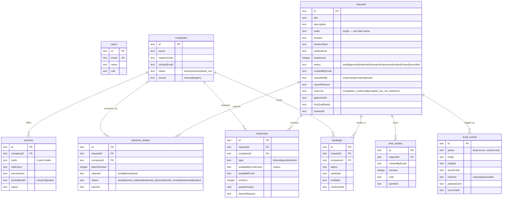

# 0.6 — Data Model v1: ERD and Completion Plan

**Status:** Current schema is live in staging/production (`migrations/0000_init.sql`,
`0001_fix_indexes.sql`). This document maps it against the 13 planned entities from
details/06 and defines the Phase 2 migrations, including the multi-trade decision
(decision log #3).

## Current ERD (live, 9 tables)

## Gap analysis vs the 13 planned entities

| Planned entity (details/06) | Status | Where it lands |
|---|---|---|
| Company | ✅ `companies` | — |
| User | ✅ `users` (staff only for pilot) | provider-side users at Phase 4 (multi-user accounts) |
| Service | ✅ `services` | — |
| **Availability declaration** | ❌ | **Migration 0002 (Phase 2):** `availability_declarations(companyId, trade, workers, dateFrom, dateTo, channel, lastConfirmedAt)` — freshness rules from details/03 key off `lastConfirmedAt` |
| **Request** | ⚠️ single-trade | **Migration 0002:** `request_trades(requestId, trade)` M:N per Decision 3 (multi-trade IN); keep `requests.trade` as primary trade during transition; matching/outreach join per trade |
| **Match** | ⚠️ implicit (outreach_entries carries batch; no ranking factors stored) | **Migration 0002:** add `match_score`, `match_factorsJson` to outreach_entries (or first-class `matches` if ranking grows) — Phase 2 wk6 with matching v1 |
| Outreach | ✅ first-class `outreach_entries` (batches, rejects, opt-outs) | — |
| Response | ✅ `responses` (capacity declaration included) | — |
| Booking | ✅ `bookings` | **Migration 0003:** first-confirmed-wins enforced via SQL constraint (partial unique index on requestId+date-range exclusion or trigger), 48 h holds table behind flag — Phase 2 wk7 |
| Document | ❌ deliberate MVP deferral (details/06 "Later" column) | R2 `eu` jurisdiction when needed (documents with expiry) |
| Review/outcome | ⚠️ outcome fields on `requests` (`completion_confirmed` / `accepted_but_not_delivered`) | ✅ sufficient for pilot metrics; `reviews` table is Phase 4 |
| Audit event | ✅ `audit_events` append-only | — |

## Phase 2 migration plan (summary)

1. **0002 — multi-trade + availability:** `request_trades`, `availability_declarations`,
   match factors on outreach; backfill `request_trades` from `requests.trade`
2. **0003 — booking hardening:** holds + first-confirmed-wins DB constraint
3. Index review after each migration (lessons from `0001_fix_indexes.sql`)
