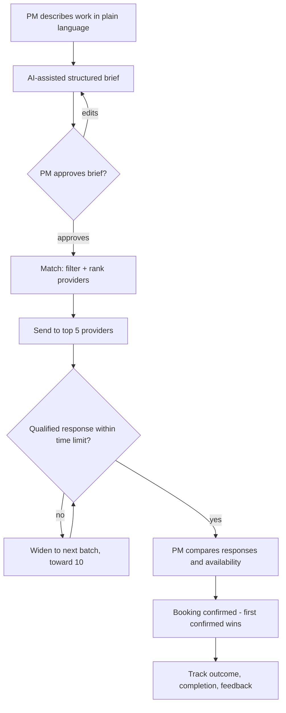
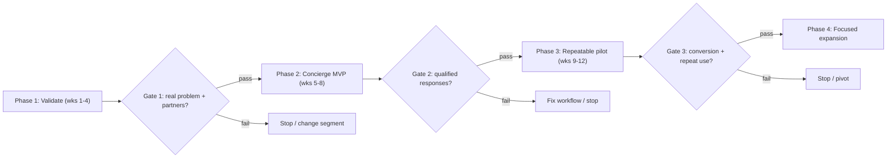

# Estonian Construction Subcontractor Marketplace — Plan

**Date:** 17 October 2026
**Market:** Estonia, starting with Tallinn and Harju County
**Stage:** Pre-validation / pre-MVP
**Purpose:** Align partners on the business opportunity, validate demand, define the first product, and agree on measurable conditions for launch and expansion.

This is the master document. Each section links to a detail file in [`details/`](details/) with the full frameworks, tables, and rules. The source drafts are preserved as `plan1.md`–`plan4.md`. The executable build and launch sequence is in [`implementation-plan.md`](implementation-plan.md).

---

## 1. Vision and problem

We want to be the fastest way for a project manager in Estonia to find a subcontractor who is actually free — and for a contractor to receive relevant jobs without paying to be listed.

**The problem today (to validate in interviews):**

- Project managers find subcontractors through phone calls, email and personal networks. It is slow and repeated for every project.
- Availability is unknown until someone replies, and a "yes" does not guarantee the crew shows up.
- Contractors lose jobs they never hear about and waste time on requests that do not fit their trade, area or capacity.
- Subcontractors who need their own subcontractors repeat the same search from scratch.

**Our answer:** a marketplace where providers list services for free, requests are matched by filter or AI chat, providers accept with one click, and a booking system shows real capacity (people free per day), not just a busy/free calendar.

**Critical success factors:**

1. **Supply liquidity in a narrow segment** before demand generation begins.
2. **Availability data quality** — project managers only trust current, reliable information.
3. **Repeat usage** — the platform must become part of the workflow, not a one-time experiment.

**First objective:** within 90 days, run a working pilot with real project managers and contractors, measure matching performance, and decide whether to build further, adjust the segment, or stop.

→ Details: [`details/01-segments-and-market.md`](details/01-segments-and-market.md)

---

## 2. Target users and pilot segment

| | Customer: project manager | Provider: contractor |
|---|---|---|
| Who | PMs at larger construction and fit-out firms | Builders, installers and trade crews, sole traders to mid-size firms |
| Main need | Find a free, qualified crew quickly and compare quotes | Receive relevant jobs and show when the crew is free |
| Pain | Slow search, unreliable availability, no-shows | Irrelevant requests, missed opportunities, unpredictable schedule |
| Why they join | Saves time, shows real capacity, audit trail | Free listing, matched leads, calendar view |
| Buying power | Company budget, approval needed | Small business, price-sensitive |

**Pilot proposal:** interior fit-out in Tallinn and Harju county — electrical, plumbing, HVAC, drywall, flooring, painting. These trades are needed together on one project, which makes multi-trade requests a natural showcase.

**Why larger firms first:** fewer, higher-value transactions, willingness to adopt tools, and the option to invite their own preferred subcontractors into the platform.

→ Details: [`details/01-segments-and-market.md`](details/01-segments-and-market.md)

---

## 3. Core user flows

Every request follows one loop: confirm the brief, send it to the best matches, widen the search if nobody accepts, then book.

Providers can start the same flow as customers when a job needs subcontractors — one account model serves both roles.

→ Details: [`details/02-user-flows.md`](details/02-user-flows.md)

---

## 4. Booking and availability

The booking system is a must-have from day one: it turns a directory into a tool people return to. MVP scope: capacity per skill per day, simple holds and conflict tracking, email fallback. Calendar sync and complex scheduling wait.

| State | How it works | How it appears to the PM |
|---|---|---|
| **Confirmed** | Provider uses the booking system or a connected calendar; the system checks free people per day | "Available from [date], [n] workers free" |
| **Tentative** | Provider marked days as soft-free or has an open hold | "Tentatively free, may change" |
| **Unconfirmed** | Provider uses no system; availability assumed, asked by email | "Availability unconfirmed, will be asked by email" |

An empty calendar never means free capacity. Freshness rules and booking rules (holds, first-confirmed-wins conflicts, reschedules) are defined in the detail file.

→ Details: [`details/03-booking-and-availability.md`](details/03-booking-and-availability.md)

---

## 5. AI features

AI helps people write better requests and plan work; people always confirm before anything is sent or booked.

| Feature | What it does | Human check |
|---|---|---|
| **Brief builder** | Turns a vague request ("redo a bathroom") into a structured brief: scope, area, dates, budget range, materials, site access | Customer edits and approves the brief |
| **Matching and ranking** | Combines filters (trade, location, price, availability) with trust signals and ranks providers | Customer sees why each provider ranks where it does |
| **Targeted outreach** | Sends the request to the top 5 first, widening toward 10 only if nobody accepts in time | Rules set by us, visible in request status |
| **Subcontractor planner** *(later)* | AI proposes how many subcontractors and which trades a job needs | Provider edits and confirms before any search starts |

**Why top 5 and not everyone:** broadcasting to every match causes notification fatigue and teaches providers to ignore us.

→ Details: [`details/04-ai-and-matching.md`](details/04-ai-and-matching.md)

---

## 6. Estonia trust layer

In construction, trust matters more than price. Estonian public registers let us verify providers more cheaply than a generic marketplace could: Äriregister (existence, activity codes), tax debt data, MTR (registered trades), Smart-ID / Mobile-ID login, profile documents with expiry tracking, reviews tied to completed bookings, and reliability metrics collected from day one. Every register use must be checked for access terms before building.

→ Details: [`details/05-trust-and-verification.md`](details/05-trust-and-verification.md)

---

## 7. MVP scope and roadmap

The MVP covers provider profiles, AI-assisted requests, ranked matching with one-click replies, and a booking system with capacity per day. Everything else waits until matching is proven.

| Area | In the MVP | Later |
|---|---|---|
| Providers | Free profile: services, area, price and pricing model | Promoted listings, documents with expiry reminders |
| Requests | Filter and AI chat that builds a structured brief | Multi-trade requests, side-by-side quote comparison |
| Matching | Ranked matching, top 5–10 notified, one-click Accept / Quote / Decline by email | Ranking tuned with real reliability data |
| Availability | Built-in booking system with capacity per day; email fallback for non-users | Google/Outlook calendar sync, reschedule flows |
| Trust | Business register check | Tax debt, activity register, Smart-ID, reviews tied to bookings |
| AI | Brief builder, ranking | Subcontractor planner |
| Companies | Request, response and booking log | Multi-user accounts, exportable audit trail |

We move to the next phase only when its gate is met. Gate criteria, kill/pivot thresholds: [`details/08-metrics-and-pilot-gates.md`](details/08-metrics-and-pilot-gates.md).

→ Scope and architecture details: [`details/06-mvp-scope-and-architecture.md`](details/06-mvp-scope-and-architecture.md)

---

## 8. Go-to-market and cold start

A marketplace is useless until both sides are present, so we build supply first inside one narrow segment and bring customers in only when search results are good.

1. **Interview before building.** ~10 project managers and ~15 contractors in the pilot segment.
2. **Seed supply.** Pre-create provider profiles from public registers and invite providers personally; listing is free. Target 30+ active providers balanced across the six pilot trades.
3. **Anchor customers.** Recruit 3–5 PMs at larger firms as design partners. They import their own preferred subcontractors, so the platform is useful on day one.
4. **Run real requests.** Concierge-style at first: we help write briefs and check responses to learn before automating.
5. **Prove matching, then expand.** Widen trades and regions only when requests get accepted reliably.

→ Details: [`details/07-gtm-and-liquidity.md`](details/07-gtm-and-liquidity.md)

---

## 9. Pilot success criteria

| Metric | Proposed target |
|---|---|
| Design partners | 3–5 active PMs with signed pilot commitments |
| Supply | 30+ active providers balanced across the six trades |
| Request success | ≥70% of eligible requests get ≥1 qualified response within 24h |
| Time to response | Median first qualified response < 4 business hours |
| Booking conversion | ≥30% of eligible requests lead to a confirmed booking |
| Repeat usage | ≥50% of active PMs submit another request |
| Availability quality | ≥70% of responding providers confirm availability |
| Reliability | Accepted-but-not-delivered rate tracked from day one |

These targets are hypotheses, refined after discovery. Every metric has a defined denominator. The most important early metric is **the percentage of eligible requests that reach a confirmed outcome within an acceptable time**.

→ Definitions, kill/pivot criteria, glossary: [`details/08-metrics-and-pilot-gates.md`](details/08-metrics-and-pilot-gates.md)

---

## 10. Monetization

**Parked for later.** The only fixed rule so far: listing and basic matching are free for providers, and the booking system interface is the paid part. Everything else — PM subscriptions, provider tools, booking fees, hybrid — is a hypothesis to test after the pilot shows what people value.

→ Details: [`details/09-monetization.md`](details/09-monetization.md)

---

## 11. Risks

The biggest risks are an empty marketplace, users leaving the platform after the first match, and unreliable availability data. The full risk table with likelihoods and mitigations — including seasonality, notification fatigue, GDPR and liability — is in the detail file.

→ Details: [`details/10-risks-and-legal.md`](details/10-risks-and-legal.md)

---

## 12. Decisions for the partner meeting

- [ ] **Pilot segment:** interior fit-out in Tallinn and Harju county, or another trade cluster or region?
- [ ] **Booking system:** build our own or adapt an existing scheduling component?
- [ ] **MVP scope:** confirm the in/out list in section 7.
- [ ] **Team and budget:** who builds, who sells, and how much time and money each partner commits until the next gate.
- [ ] **Company and legal set-up:** entity, ownership split, terms of use, GDPR review.
- [ ] **Success criteria:** numeric targets and the point at which we stop, change or expand.

Every decision gets an owner and a deadline.

## 13. Roles

| Role | Responsibility | Owner |
|---|---|---|
| Product and customer research | Interviews, requirements, priorities | To assign |
| Engineering | Platform, booking system, integrations | To assign |
| Supply and sales | Onboarding providers and anchor customers | To assign |
| Operations | Request handling, provider follow-up, outcome tracking | To assign |
| Legal and finance | Terms, GDPR, company set-up | To assign |

No substantial development starts until responsibility for delivering and operating the pilot is clear.

## 14. Next 30 days

- [ ] Hold the partner meeting and settle the decisions above
- [ ] Write interview guides for project managers and contractors
- [ ] Complete the interviews (~10 PMs, ~15 contractors)
- [ ] Research existing Estonian portals, procurement tools and scheduling software
- [ ] Check access and terms for the public registers listed in section 6
- [ ] Draft the data model: provider, service, capacity, request, response, booking, outreach
- [ ] Sketch key screens: provider onboarding, request via AI chat, response email, availability view
- [ ] Define analytics events for the full funnel before the first line of product code

**Deliverable at day 30:** prioritised MVP specification, 60-day delivery plan, cost estimate, and an explicit go/no-go decision.

---

## Final recommendation

Proceed with a tightly scoped validation and concierge pilot — not a full-scale marketplace build.

The strongest version of this business will not be the platform with the most features or the most advanced AI. It will be the platform that reliably solves a costly, recurring problem for a focused group of construction companies.

**The first milestone is not launching a marketplace. It is proving that a project manager can use the platform to find and secure a suitable subcontractor faster and with greater confidence than through their current process.**

If we demonstrate that outcome repeatedly, we have a credible foundation for the product, the provider network, and a sustainable business.
